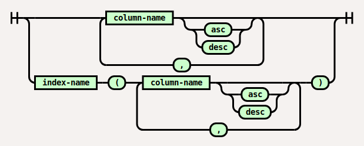
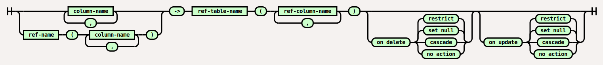

# mojoz

[](https://central.sonatype.com/artifact/org.mojoz/mojoz_3)


Manages relational database table metadata and query definitions.
Generates SQL [DDL](https://en.wikipedia.org/wiki/Data_definition_language) statements from table metadata.
Generates Scala classes or [XSD](https://en.wikipedia.org/wiki/XML_Schema_(W3C)) to receive query results.
Used by [querease](https://github.com/guntiso/querease) to save and retrieve data.

## Table metadata

Table metadata is typically loaded from YAML resource files bundled with application
(see [YamlTableDefLoader](https://static.javadoc.io/org.mojoz/mojoz_3/7.2.0/org/mojoz/metadata/in/YamlTableDefLoader.html)).
Table metadata can also be extracted from
[java.sql.DatabaseMetaData](https://docs.oracle.com/en/java/javase/11/docs/api/java.sql/java/sql/DatabaseMetaData.html)
using JDBC connection and saved to yaml files for later use
(see [JdbcTableDefLoader](https://static.javadoc.io/org.mojoz/mojoz_3/7.2.0/org/mojoz/metadata/in/JdbcTableDefLoader$.html)).

[Yaml 1.2](https://yaml.org/spec/1.2/) syntax is used for table metadata, but some keys and values are further parsed by mojoz.

If file does not start with '%' (yaml [directives](https://yaml.org/spec/1.2.2/#68-directives))
or '-' (yaml [collections](https://yaml.org/spec/1.2.2/#21-collections))
and does not contain [document markers](https://yaml.org/spec/1.2.2/#912-document-markers) `---` or `...` then empty lines are used as delimiters
and resulting parts are parsed separately. Otherwise file, which can contain multiple definitions, is parsed as a whole -
see [tables-in-as-multidoc.yaml](src/test/resources/tables-in-as-multidoc.yaml).
To share nodes between definitions using yaml [anchors](https://yaml.org/spec/1.2.2/#692-node-anchors)
and [aliases](https://yaml.org/spec/1.2.2/#71-alias-nodes), definitions can be put in collection -
see [tables-in-as-array.yaml](src/test/resources/tables-in-as-array.yaml).

Key names for table definitions are:

* **db** - database name
* **table** - table name
* **comments**
* **columns** - collection of columns
* **pk** - primary key. If not provided, might be implied (based on columns) to be `id` or `code` or a pair of refs,
  as defined in [MdConventions](https://static.javadoc.io/org.mojoz/mojoz_3/7.2.0/org/mojoz/metadata/io/MdConventions.html).fromExternalPk
* **uk** - collection of unique keys
* **idx** - collection of indices
* **refs** - collection of customized or additional references to columns (foreign keys)
* any other (custom) keys can be used and are sent to `extras` field of [TableDef](https://static.javadoc.io/org.mojoz/mojoz_3/7.2.0/org/mojoz/metadata/TableDef.html)
  by YamlTableDefLoader.

For example, table definition
```yaml
table:   person
columns:
- id
- name                 ! 51
- surname                52
- mother.id              person.id
- father.id              person.id
```
corresponds to the following sql (as converted by [DdlGenerator](https://static.javadoc.io/org.mojoz/mojoz_3/7.2.0/org/mojoz/metadata/out/DdlGenerator$.html)):
```sql
create table person(
  id bigint,
  name varchar(51) not null,
  surname varchar(52),
  mother_id bigint,
  father_id bigint
);

alter table person add constraint pk_person primary key (id);

alter table person add constraint fk_person_mother_id foreign key (mother_id) references person(id);
alter table person add constraint fk_person_father_id foreign key (father_id) references person(id);
```
### Columns

Column information is mostly contained in yaml string or key except for comment which is \[first string\] value for the key.
General pattern for column information is:
```
name [nullability] [type] [length_or_total_digits] [fraction_digits] [(enum)] [= default] [: comments]
```
where
* _name_ is column name or for refs - _table_name.column_name_ or _alias.column_name_ (dot (.) is replaced with underscore(\_) to create column name)
* _nullability_ is optional exclamation mark (!) meaning **not** null
* _type_ is optional type name or for refs - optional _table_name.column_name_
* _length_or_total_digits_ is optional column length or total digits for number columns
* _fraction_digits_ is optional fraction digits for decimals
* _enum_ is optional list of comma and/or space separated values for the column (to enable spaces in values, all values should be wrapped in single quotes ('))
* _default_ is optional default value for the column
* _comment_ is optional text
* additionally, any (custom) keys can be used and are sent to `extras` field of [ColumnDef](https://static.javadoc.io/org.mojoz/mojoz_3/7.2.0/org/mojoz/metadata/ColumnDef.html)
  by YamlTableDefLoader.

### Indices (pk, uk, idx)



If index name is not provided [DdlGenerator](https://static.javadoc.io/org.mojoz/mojoz_3/7.2.0/org/mojoz/metadata/out/DdlGenerator.html) uses
[ConstraintNamingRules](https://static.javadoc.io/org.mojoz/mojoz_3/7.2.0/org/mojoz/metadata/out/DdlGenerator$$ConstraintNamingRules.html)
to create automatic index name.

Examples:
```yaml
idx:
- id
- id, col1
- idx_col2(col2)
- idx_col3_col4(col3, col4)
- idx_col3_col5d(col3, col5 desc)
```

### Refs (foreign keys)

Refs are implied from column definitions where column name or type is _table_name.column_name_. Refs can be defined explicitly for: name customization, multi-column ref creation or _on delete_ / _on update_ settings.


If ref name is not provided [DdlGenerator](https://static.javadoc.io/org.mojoz/mojoz_3/7.2.0/org/mojoz/metadata/out/DdlGenerator.html) uses
[ConstraintNamingRules](https://static.javadoc.io/org.mojoz/mojoz_3/7.2.0/org/mojoz/metadata/out/DdlGenerator$$ConstraintNamingRules.html)
to create automatic ref name.

Examples:
```yaml
refs:
- bank_id -> bank(id) on delete cascade
- code, name -> table1(code, col1) on delete cascade
- fk_table2_custom_name(code, name) -> table2(code, col2)
```

## View metadata

View metadata is typically loaded from YAML resource files bundled with application
(see [YamlViewDefLoader](https://static.javadoc.io/org.mojoz/mojoz_3/7.2.0/org/mojoz/metadata/in/YamlViewDefLoader.html)).
A view is a named set of fields, usually mapped to a table, used to generate Scala classes or
[XSD](https://en.wikipedia.org/wiki/XML_Schema_(W3C)) and, in [querease](https://github.com/guntiso/querease),
to query and persist data.

[Yaml 1.2](https://yaml.org/spec/1.2/) syntax is used for view metadata, but some keys and values are further parsed by mojoz.
YAML files are split and parsed as described for [table metadata](#table-metadata) —
see [views-in-as-multidoc.yaml](src/test/resources/views-in-as-multidoc.yaml)
and [views-in-as-array.yaml](src/test/resources/views-in-as-array.yaml).

Key names for view definitions are:

* **name** - view name (required)
* **db** - database name
* **table** - table name, optionally followed by alias (`person p`)
* **column** - optional table column (typically json) whose structure the view describes
* **comments**
* **extends** - name of another view to inherit from
* **joins** - from-clause fragments (typically [tresql](https://github.com/mrumkovskis/tresql))
* **filter** - where-clause fragments
* **group** - group-by expressions
* **having** - having-clause fragments
* **order** - order-by expressions
* **distinct** - `true` / empty for `DISTINCT`, `false` to disable, or column list for `DISTINCT ON`
* **save-to** - table(s) to persist to (used by [querease](https://github.com/guntiso/querease))
* **fields** - collection of fields
* any other (custom) keys can be used and are sent to `extras` field of [ViewDef](https://static.javadoc.io/org.mojoz/mojoz_3/7.2.0/org/mojoz/metadata/ViewDef.html)
  by YamlViewDefLoader. [querease](https://github.com/guntiso/querease) uses extras such as `key`;
  [wabase](https://github.com/mrumkovskis/wabase) uses extras such as `api`, `auth`, `paths` and action steps.

For example, given the `person` table above, view definition
```yaml
name:    person
table:   person
fields:
- id
- name
- surname
- mother.name
- father.name
```
corresponds to the following Scala (as converted by [ScalaGenerator](https://static.javadoc.io/org.mojoz/mojoz_3/7.2.0/org/mojoz/metadata/out/ScalaGenerator.html)):
```scala
class person {
  var id: java.lang.Long = null
  var name: String = null
  var surname: String = null
  var mother_name: String = null
  var father_name: String = null
}
```
`mother.name` and `father.name` follow the `mother.id` / `father.id` refs from the table definition.
Dots in a field name become underscores in the generated field name unless an alias is given.

More examples: [views-in.yaml](src/test/resources/views-in.yaml),
[querease](https://github.com/guntiso/querease) and [wabase](https://github.com/mrumkovskis/wabase).

### Fields

Field information is mostly contained in yaml string or key except for comment which is \[first string\] value for the key,
and except for an inline child view which is a mapping value (or additional keys).
General pattern for field information is:
```
name [options] [cardinality] [join] [type] [length_or_total_digits] [fraction_digits] [#(order_by)] [(enum)] [= expression] [-> [save_to] [= resolver]] [: comments]
```
where
* _name_ is field name, column name, or a path — _table_name.column_name_, _alias.column_name_, or several steps (`mother.father.surname`)
* _options_ is optional persistence options in square brackets, used by [querease](https://github.com/guntiso/querease):
  * `+` insert, `=` update, `-` delete (children), `!` read-only
  * `?` optional field ([ScalaGenerator](https://static.javadoc.io/org.mojoz/mojoz_3/7.2.0/org/mojoz/metadata/out/ScalaGenerator.html) emits `Option`, missing value is omitted)
  * `/` separates options for this field from options for a referenced child (`[/!]` updates the ref, does not save the child)
* _cardinality_ is optional `!` (not null), `?` (nullable), `*` (collection) or `+` (non-empty collection).
  If omitted, nullability is taken from the column; outer joins make the field nullable
* _join_ is optional `[join to parent]` condition for a child view
* _type_ is optional type name or child view name
* _length_or_total_digits_ is optional field length or total digits for number fields
* _fraction_digits_ is optional fraction digits for decimals
* _order_by_ is optional `#(expression)` used to order a child collection (`~` in tresql means descending)
* _enum_ is optional list of comma and/or space separated values (to enable spaces in values, all values should be wrapped in single quotes ('))
* _expression_ is optional query expression for the field (typically tresql).
  If the expression is a qualified identifier, it is treated as a column (alias = name).
  Prefix `()` to keep a no-arg function or pseudo-column as an expression
* `->` marks a resolvable field: when saving, the field value is converted to a column value
  * _save_to_ is optional target column (implied from name or from a unique ref if omitted)
  * _resolver_ is optional expression that calculates the value to be saved (`_` is the field value)
* _comment_ is optional text
* additionally, any (custom) keys can be used and are sent to `extras` field of [FieldDef](https://static.javadoc.io/org.mojoz/mojoz_3/7.2.0/org/mojoz/metadata/FieldDef.html)
  by YamlViewDefLoader.

If the view has a **table**, field types, enums, comments and nullability default from the corresponding column.
If there is no table, types follow [MdConventions](https://static.javadoc.io/org.mojoz/mojoz_3/7.2.0/org/mojoz/metadata/io/MdConventions.html)
(`id` / `*_id` → long, `is_*` / `has_*` → boolean, `*_date` → date, `*_time` → dateTime, otherwise string).

Examples:
```yaml
fields:
- id
- name                  !
- surname               ?
- country_code                        (LT, LV, RU)
- country.name          ?
- full_name                             = name || ' ' || surname
- last_modified           date          : Last modified
- number                [?]             # optional - omit if missing
- read_only             [!]
- insert_only           [+]
- update_only           [=]
```

### Nested views

A field can be a child view (complex type) — either by naming another view or by defining one inline.
Cardinality `*` or `+` makes it a collection. Anonymous inline views are named `{parent}_{field}`.

```yaml
name:  person_info
table: person p
fields:
- name
- surname
- mother.name
- father.name
- children * [p.id in (c.mother_id, c.father_id)]:
    table:  person c
    fields: name
    order:  name
- father [f.id = p.father_id]:
    table:  person f
    fields:
    - name
    - surname
```

```yaml
name: country
table: country
fields:
- code
- name
- banks [+-=] * :          # insert, update and delete children
    table: bank
    fields:
    - code
    - name
```

```yaml
name: organization
table: organization
fields:
- name
- accounts [?] * :         # optional collection
    table: organization_account
    fields:
    - number
    - balance
- main_account [/!]:       # update the ref, do not save the child
    table: organization_account
    fields:
    - number
    - balance
```

Child views inherit **db** from the parent unless **db** is set (including empty to use the default database).
Empty **save-to** on a child means the child is not persisted as its own row.
If persistence options are omitted, simple fields are inserted and updated;
children are inserted and deleted, not updated, unless `=` is set.

### Expressions and resolvers

`=` introduces an expression used when querying. `->` introduces save-time resolution used by
[querease](https://github.com/guntiso/querease). They can be combined.

```yaml
name:  resolver_test_1
table: person
fields:
- id
- mother = mother.name || mother.surname -> mother_id
- father = father.name || father.surname -> father_id = person[name || surname = _]{id}
```

```yaml
fields:
- name -> = 'My bank'
- name -> = _ || ' saved'
- name = name || '.' ->
- last_modified -> = now()
```

### Extends, joins and query clauses

**extends** copies the base view's table (if not set), comments (if empty), joins, filter, group, having, order, extras
and fields. Fields with the same name override the base field and must be type-compatible.
Joins, filter, group, having and order of the extending view are appended.

**joins**, **filter**, **group**, **having** and **order** are stored as strings and used by
[querease](https://github.com/guntiso/querease) to build queries.
Joins are typically tresql from-clause fragments; a `JoinsParser`
(provided by querease, passed to YamlViewDefLoader) is used to resolve aliases.

```yaml
name:   person_and_car
table:  person p
joins:
- p / car_schema.person_car car
fields:
- id
- name
- car_name = car.car_name
filter:
- name
order:
- name
- id
```

```yaml
name:     organization_with_facts
table:    organization o
save-to:
- organization
- organization_facts
joins:
- o/[o.id = f_.id]organization_facts f_
fields:
- id
- name
- actual_address  [a.id = f_.actual_address_id] address
- legal_address   [a.id = o.legal_address_id]   address
```

```yaml
name: account_details
extends: account
fields:
- bank.code
- bank.name
- billing_account 64 = 'Account = ' || billing_account
```

## Types

Default supported types are defined in [mojoz-default-types.yaml](src/main/resources/mojoz-default-types.yaml).
Types can be customized and additional types can be added by including **mojoz-custom-types.yaml** file in resources.
Key names are:
* **type** - [mojoz] type name
* **_[some]_ name** - type name for specific purpose:
  * **scala name** - used by [ScalaGenerator](https://static.javadoc.io/org.mojoz/mojoz_3/7.2.0/org/mojoz/metadata/out/ScalaGenerator.html)
  * **xsd name** - used by [XsdGenerator](https://static.javadoc.io/org.mojoz/mojoz_3/7.2.0/org/mojoz/metadata/out/XsdGenerator.html)
  * any other (custom) name will also be loaded into
    `targetNames` field of [TypeDef](https://static.javadoc.io/org.mojoz/mojoz_3/7.2.0/org/mojoz/metadata/TypeDef.html)
    by [YamlTypeDefLoader](https://static.javadoc.io/org.mojoz/mojoz_3/7.2.0/org/mojoz/metadata/in/YamlTypeDefLoader.html)
* **jdbc** - type mappings from JDBC,
  used by [JdbcTableDefLoader](https://static.javadoc.io/org.mojoz/mojoz_3/7.2.0/org/mojoz/metadata/in/JdbcTableDefLoader$.html)
  to map jdbc type to mojoz type
  * **_[some db]_ jdbc** - db-specific type mappings from JDBC
* **yaml** - type mappings for table and view metadata loading from mojoz yaml files,
  used by [YamlTableDefLoader](https://static.javadoc.io/org.mojoz/mojoz_3/7.2.0/org/mojoz/metadata/in/YamlTableDefLoader.html)
  and [YamlViewDefLoader](https://static.javadoc.io/org.mojoz/mojoz_3/7.2.0/org/mojoz/metadata/in/YamlViewDefLoader.html)
* **sql** - type info used by [DdlGenerator](https://static.javadoc.io/org.mojoz/mojoz_3/7.2.0/org/mojoz/metadata/out/DdlGenerator$.html),
  can be overiden for specific database, for example:
  * **oracle sql** - type name specific to Oracle
  * **postgresql** - type name specific to PostgreSQL
  * **_[other db]_ sql** - any other keys ending with `sql` will also be loaded into
    `ddlWrite` field of [TypeDef](https://static.javadoc.io/org.mojoz/mojoz_3/7.2.0/org/mojoz/metadata/TypeDef.html)
    by [YamlTypeDefLoader](https://static.javadoc.io/org.mojoz/mojoz_3/7.2.0/org/mojoz/metadata/in/YamlTypeDefLoader.html)
    and can be used by corresponding sql generator.

Example:
```yaml
type:       euro
xsd name:   decimal
scala name: scala.math.BigDecimal
yaml:
- euro
sql:
- numeric(12, 2)
```

## [API docs](https://static.javadoc.io/org.mojoz/mojoz_3/7.2.0/org/mojoz/metadata/index.html)
